# Building Aware (JAMES) — Getting Started Training Guide

> **NotebookLM / Gemini Notebook Usage Note:**  
> This document is structured as a modular classroom training guide and source brief for generating a **Training Video, Podcast (Audio Overview), Infographic, and Slide Deck**.

---

## 1. Purpose: Why Building Aware (JAMES)?

**Building Aware (JAMES)** is an **Electrical Digital Twin** platform designed for facility engineers, electrical surveyors, and commissioning teams. Instead of scattering facility data across static PDFs, spreadsheets, and disconnected CAD drawings, JAMES unifies field data collection and engineering modeling into a single live system:

* **Capture Once in the Field:** Record equipment nameplates, photos, panel schedules, feeder cables, and NEC/NFPA/IEEE inspection checklists directly on a tablet or laptop.
* **Compile Automatically:** As equipment is linked to its upstream power source (`Fed From`), JAMES automatically builds the facility power tree, interactive Single-Line Diagram (SLD), and deterministic IEEE 315 / ANSI AutoCAD drawings (`.DXF`).
* **Audit Continuously:** Run automated engineering rule checks for voltage mismatches, breaker capacity headroom, short-circuit withstand (AIC), and feeder voltage drop (`<3%`).

**Core 3-Step Workflow:**
1. **Catalog Archetypes** (Standardize OEM equipment & breaker specs in Catalog Studio)
2. **Survey Ledger** (Collect physical field data, photos, checklists & upstream feeds)
3. **SLD Compilation & Audit** (Visualize the hierarchy, run Integrity Audits & export CAD/reports)

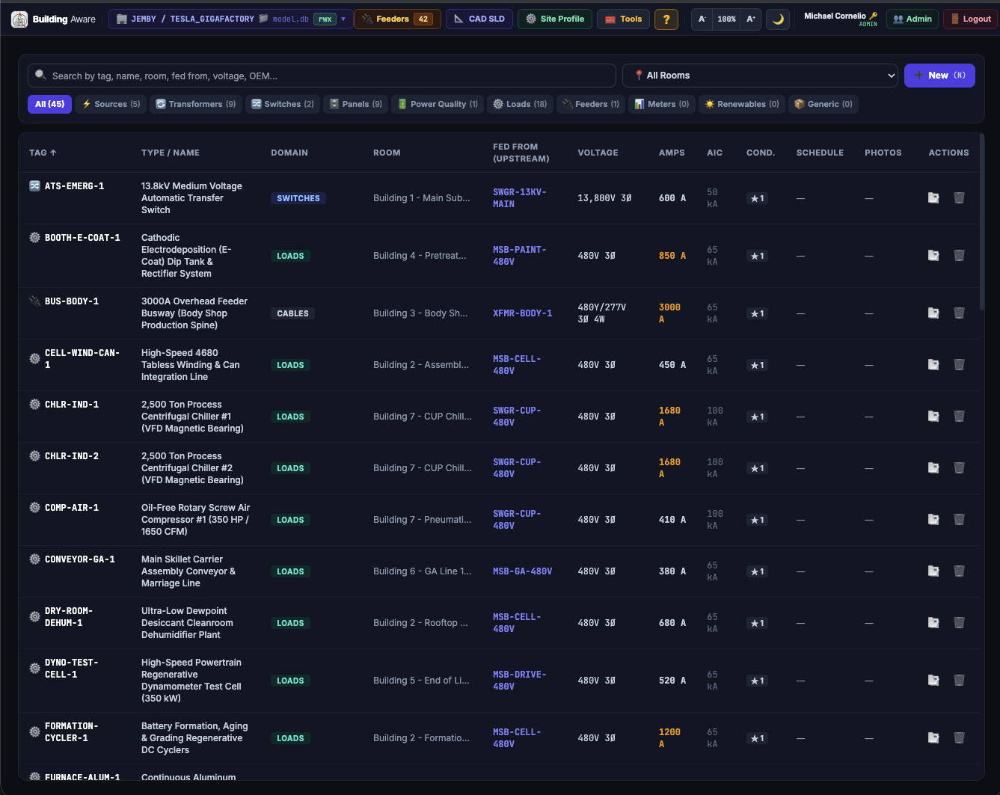

---

## 2. Databases (Site Files / Facility Collections)

Every client site in Building Aware is stored as an isolated **Facility Database** (`model.db` SQLite collection) organized by **Client Organization** and **Facility ID** (for example: `FREMONT_COMMUNITY_CHURCH / MAIN_BUILDING` or `JEMBY / TESLA_GIGAFACTORY`).

### Opening, Switching, and Creating Databases
* **Facility DB Pill (Top-Left Header):** Shows the active `CLIENT / FACILITY` and `📁 model.db`. Click it—or press **`Cmd/Ctrl + O`** or open **Toolbox (`🧰`) → `📁 Files / Finder`**—to switch sites.
* **Creating a New Facility Database:**
  1. Open the Facility Finder modal and click **`+ New Facility Database`**.
  2. Enter the **Client ID** and **Facility ID**.
  3. Optionally check **"Seed with standard industrial hierarchy templates"** to start with a pre-built starter distribution tree.
  4. Click **`Create & Switch`** to load the new database immediately.
* **Access Badge (`rwx` / `rw-` / `r--`):** The Facility DB Pill displays your Linux-style effective permission level for the current facility (`rwx` = full access, `rw-` = read/write, `r--` = read-only).

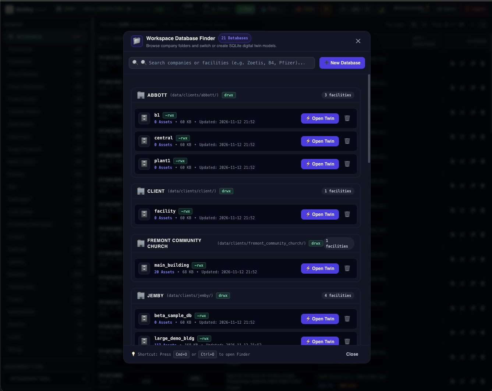

---

## 3. Tool Bar: Tools | CAD SLD | Site Profile (and Header Controls)

The top control bar keeps primary engineering tools one click away across both the Survey Ledger and Diagram views.

### Top-Bar Action Buttons
* **`🔌 Feeders` (Hotkey: `C`)**: Opens the **Feeder & Conductor Schedule** modal with a live badge showing total feeder runs.
* **`📐 CAD SLD`**: Launches the **AutoCAD Single-Line Diagram** generator:
  * **Multi-Sheet & Sizes:** Select drawing sheets (`E-001`, etc.) and toggle sheet size between **`36×24` (ANSI D)** and **`42×30` (ARCH E1)**.
  * **Label & Schedule Table Layouts:** Switch between **`Linear (Horizontal)`**, **`Stacked (Vertical)`**, **`Schedule Tables (Right)`**, and **`Schedule Tables (Left)`** (featuring 3-letter domain tags such as `SRC0001`, `TRF0029`, `PNL0042` and `FDR` feeder schedule tables).
  * **Visual Modes & Export:** Toggle **`Light` / `Dark`**, **High Contrast (`☯ ON/OFF`)**, zoom/pan, **`🔄 Re-compile`**, and **`📥 Download .DXF`** (AutoCAD R2018 organized into AIA CAD layers: `E-ELEC-BUS`, `E-ELEC-FEED`, `E-ELEC-SYMB`, `E-ANNO-TEXT`, `E-ANNO-CABL`).
* **`⚙️ Site Profile`**: Opens the 4-tab **Site Configuration & Electrical Profile** modal:
  1. **Identity & Address** (Site name, physical location)
  2. **Electrical Service** (Incoming service voltage, e.g., `480Y/277V` or `208Y/120V`)
  3. **Utility Company** (Serving utility details)
  4. **Contacts** (Onsite facility and engineering contacts)
* **`🧰 Tools` (Toolbox Bento Palette)**: Opens the central **Field Tools & System Controls** grid:
  * **Workbenches & Views:** `📋 Survey Ledger`, `⚡ Diagram`, `📖 Catalog Studio`, `⚙️ Site Profile`, `📁 Files / Finder`
  * **System Integrity Audit (`🛡️`)** hero tile with live Health Score (`0–100`)
  * **Feeder & Conductor Schedule (`🔌`)** hero tile with `<3% Drop` compliance count
  * **Add Equipment Archetype (`➕`, hotkey `N`)** & **Database / Site Profile (`🏢`)**
  * **Export Model & Reports:** `📝 Markdown (TOC)`, `📊 CSV Sheet`, `📦 Model JSONL`, `📄 Print / PDF ↗`
  * **Field Guide & Knowledge Base (`❓`, hotkey `?`)**
* **Header Utilities:** **`?`** (Field Guide & FAQ), **`A⁻ | 100% | A⁺`** (font scaling), **`🌙 / ☀️`** (Dark/Light mode), **`🔑`** (My Account & Change Password), and **`🛡️`** (Admin-only User & Access Console).

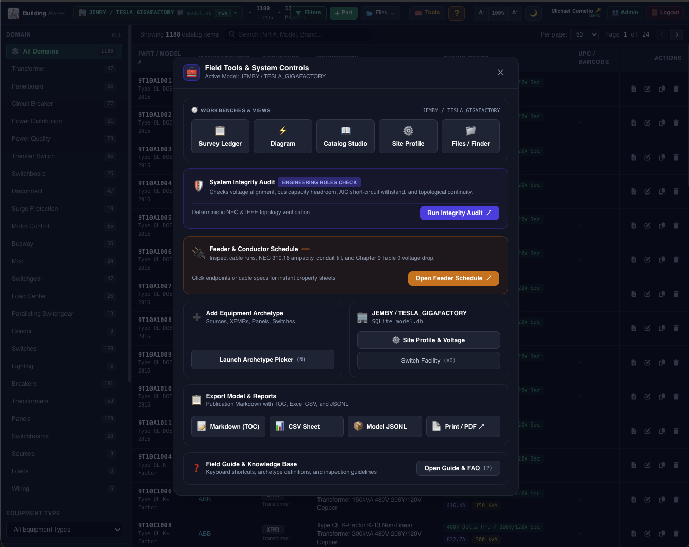

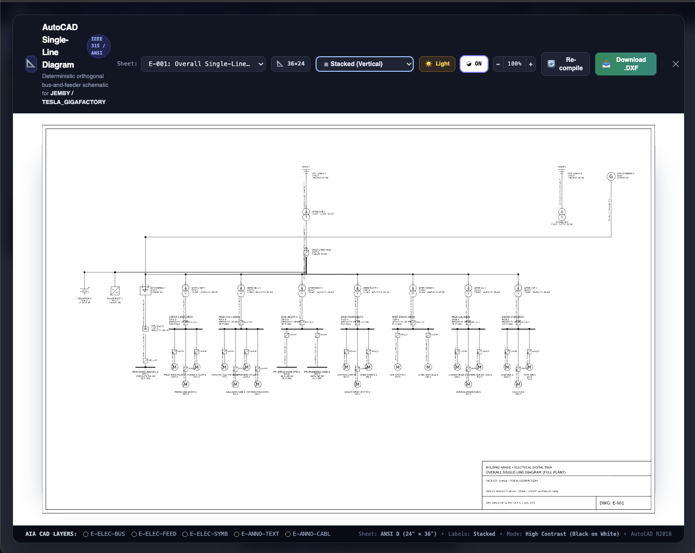

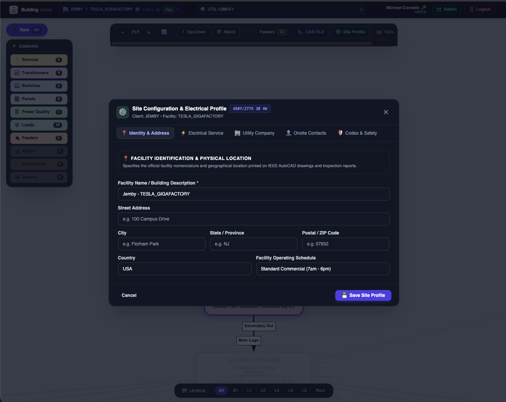

---

## 4. Catalog Studio (Master Catalog)

**Catalog Studio** (`📖 Catalog Studio`, accessed from **Toolbox `🧰` → Workbenches & Views**) is the master library of standardized OEM electrical equipment and circuit breakers.

### Key Capabilities
* **Verified OEM Libraries:** Browse pre-populated manufacturer specs (e.g., Square D, Eaton, Siemens) with frame sizes, interrupting capacities (AIC), mounting styles (Bolt-on / Plug-in), voltage ratings, and cut-sheet links.
* **Domain & Archetype Filtering:** Cascade filter by electrical domain and equipment archetype, or search by part number/brand.
* **Create, Clone & Import:** Add new catalog parts, clone existing archetypes, attach custom specifications, or bulk-import catalog items via JSON.
* **Direct Survey Integration:** When adding equipment in the Survey Ledger or selecting a breaker in the Panel Schedule, dropdowns pull directly from the Master Catalog to auto-fill verified ratings.

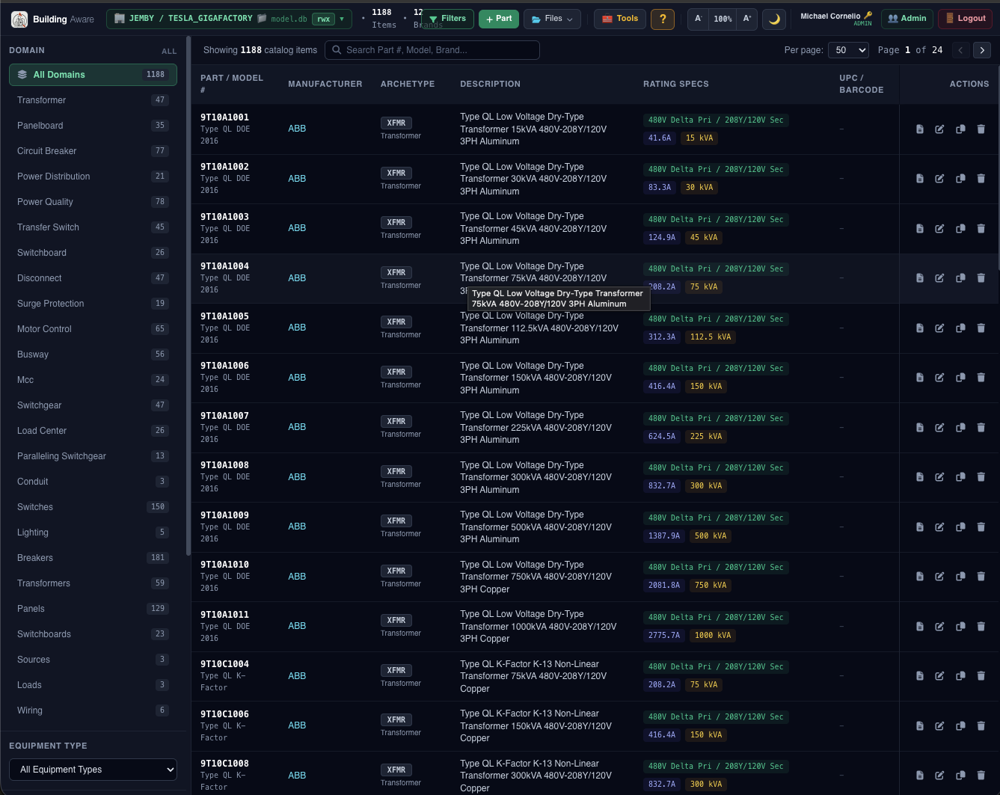

---

## 5. Survey Ledger (Parts Table)

The **Survey Ledger** (`📋 Survey Ledger`) is the primary field data-collection table for inventorying and editing every electrical asset in the facility.

### Classroom Walkthrough: Adding & Editing Assets
1. **Add Equipment:** Click **`+ Add Equipment`** (or press hotkey **`N`**) to open the Equipment Archetype Picker.
2. **Choose Archetype or Catalog Template:** Select the equipment type (e.g., Utility Source, Transformer, Switchboard, Panelboard, Disconnect Switch, Motor/Load).
3. **Enter Core Identity:** Assign the Equipment Tag (e.g., `MSB-1`, `LP-A`, `T-1`), Name, Location (Floor/Room), and electrical ratings.
4. **Link Upstream Power (`Fed From`):** In **Electrical Ratings & Supply**, select the parent equipment supplying power to this asset (or **`Main Service / Utility Feed`** for service entrances).
5. **Inspect & Edit Anytime:** Tap any row in the Survey Ledger to slide open the **Equipment Editor Drawer** without leaving the table.

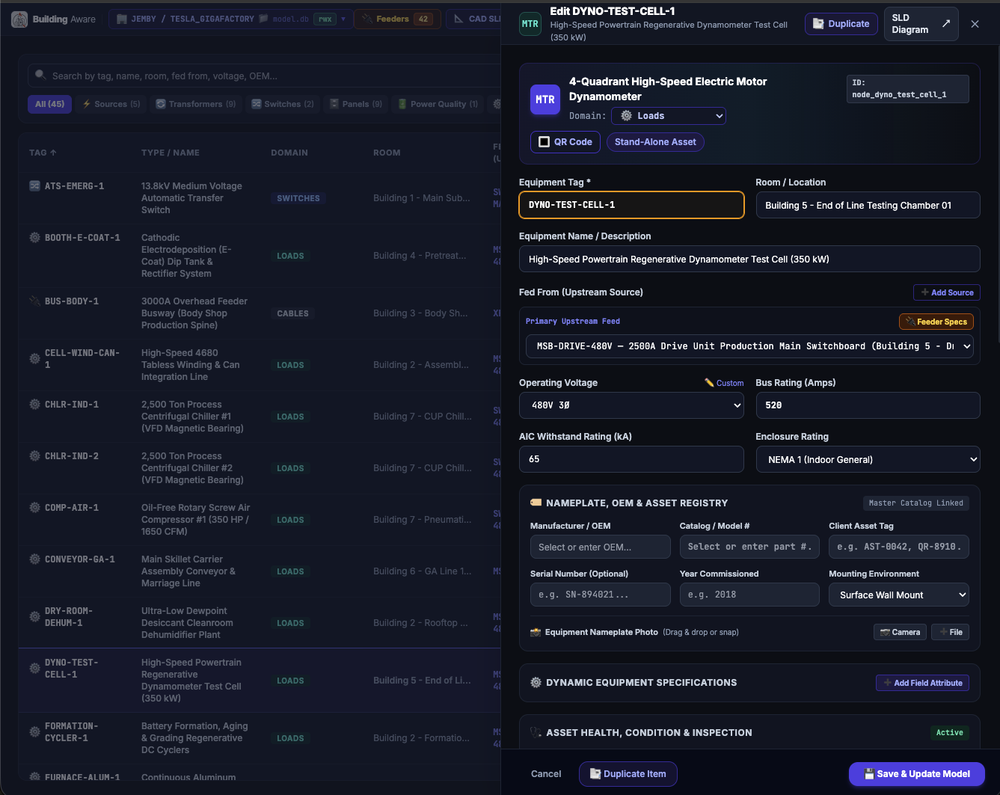

---

## 6. Diagram (Parts Hierarchy Diagram)

The **Diagram** (`⚡ Diagram`, accessed via **Toolbox `🧰` → Workbenches & Views**) is an interactive single-line power hierarchy compiled live from the `Fed From` relationships in the Survey Ledger.

### Navigation & Inspection Controls
* **Spotlight Search (`Cmd/Ctrl + K` or `/`):** Jump straight to any device or panel in large facilities.
* **Zoom & Fit:** Use **`+ / -`** (or pinch on touchscreens) to zoom, and **`0`** or **`R`** to reset fit to viewport.
* **Flow Direction (`H`):** Toggle between **Top-Down (`TB`)** and **Left-Right (`LR`)** tree layouts.
* **Level of Detail (`M`):** Switch between **Macro** (equipment blocks only) and **Detailed** (shows individual breaker slots and feeder ratings).
* **Click-to-Edit:** Tap any equipment box or cluster on the diagram to open the slide-over Equipment Editor Drawer and update ratings in real time.

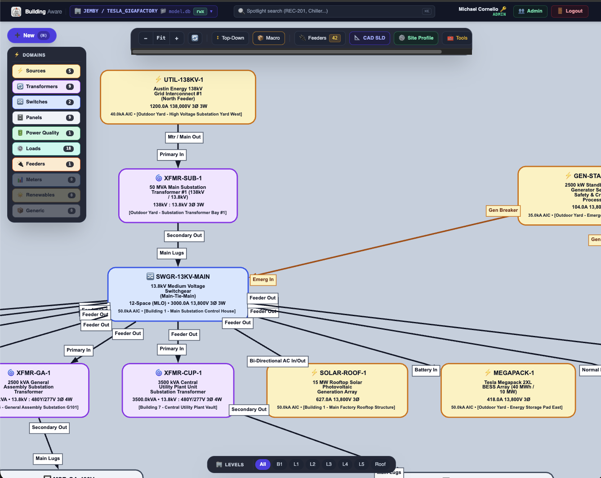

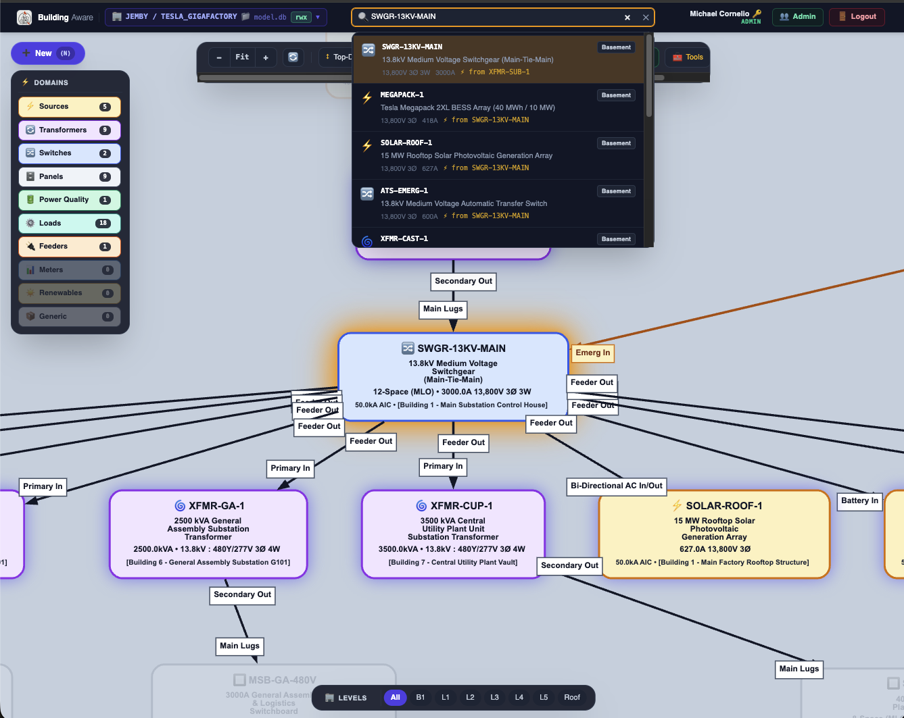

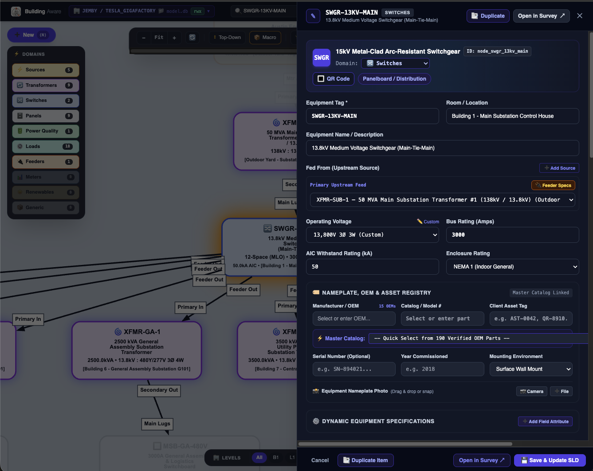

---

## 7. Parts: Devices and Feeders (Cables)

In Building Aware, the electrical twin is built from two complementary part types: **Devices** (nodes) and **Feeders** (cables/edges).

### A. Devices (Equipment & Panel Schedules)
* **Equipment Domains:** Covers Sources/Utilities, Transformers, Switchboards/Panelboards, Switches/Disconnects, Solar/Inverters, and Motors/Loads.
* **Panel Schedule & Feeder Configuration:** Inside any Panelboard or Switchboard drawer:
  * Supports **1-Pole, 2-Pole, and 3-Pole** breakers with odd/even slot interleaving (e.g., Poles 1, 3, 5 vs. 2, 4, 6).
  * Pick OEM breakers from the **Master Catalog Breaker** dropdown (filtered by pole count) or enter custom ratings.
  * **Unresolved Connected Loads:** When downstream equipment lists a panel as its `Fed From` source without an assigned breaker slot, JAMES displays an amber **`⚠️ Unresolved Connected Loads`** card with a one-click **`Resolve`** button.

### B. Feeders (Cables & Conductors)
* **Feeder & Conductor Schedule (`🔌 Feeders` or hotkey `C`):** Lists every feeder run between upstream breakers and downstream devices.
* **Engineering Calculations:** Evaluates **NEC 310.16 ampacity**, conduit fill, and **Chapter 9 Table 9 voltage drop** (tracking **`<3% Drop`** compliance).
* **Cable Property Drawer:** Click any feeder endpoint or cable specification row to inspect or edit conductor size, material, ground, parallel sets, and conduit type.

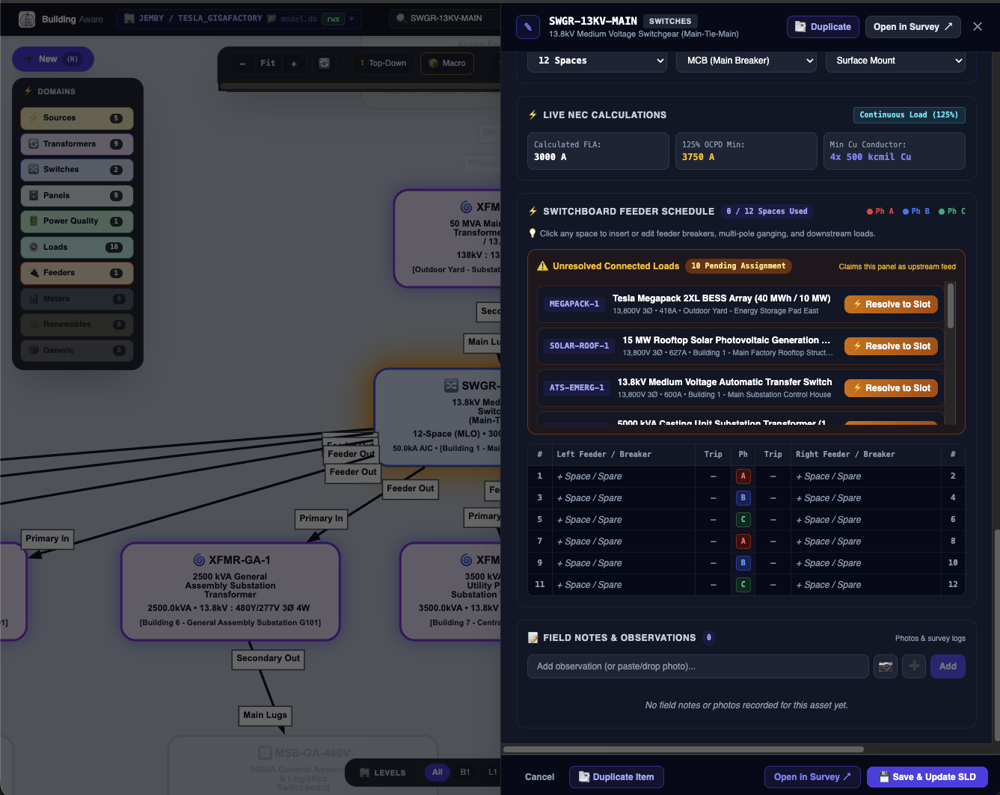

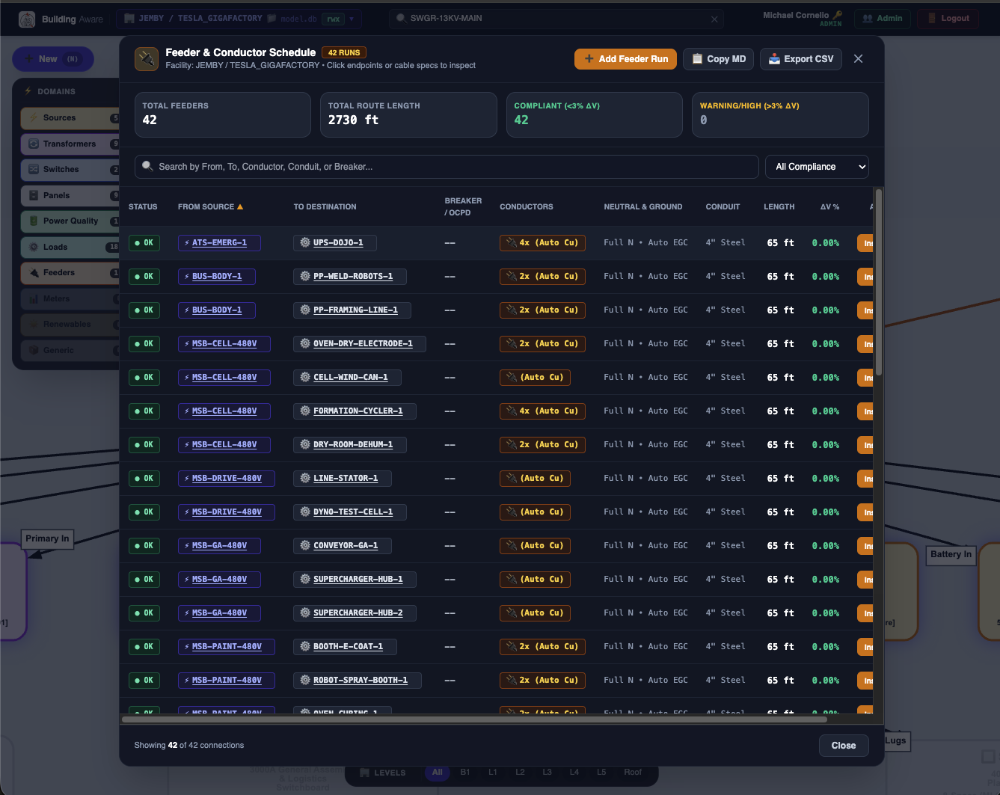

---

## 8. Other Key Features

* **System Integrity Audit (`🛡️`):** Run from **Toolbox (`🧰`) → `Run Integrity Audit`**. Scores facility health (`0–100`), flags unstepped voltage drops (e.g., `480V → 208V` without a transformer), checks breaker headroom and low-AIC withstand ratings, provides **`Inspect Asset ↗`** deep links, and exports publication-ready **PDF**, **Markdown (TOC)**, **CSV**, and **JSONL** reports.
* **Inspection Checklists:** Domain-specific NEC, NFPA, and IEEE checklists inside the Equipment Editor Drawer with **`Pass` / `Deficient` / `N/A`** toggles, one-tap defect chips (`+ Label Missing`, `+ Torque Unverified`, `+ Clearance < 36"`), compliance percentage meter, and inspector sign-off.
* **Nameplate Photos, Field Notes & Lightbox:** Capture camera photos on tablets or upload files, attach timestamped field notes, and inspect details in a zoomable Lightbox.
* **Asset QR Codes & Thermal Labels:** Click **`QR Code`** in any Equipment Editor Drawer header to generate thermal labels (**`4x2`**, **`2x2`**, **`2x1`**, or **`40x30mm`**) that link to the mobile QR device view.
* **Field Guide & Knowledge Base (`?`):** Built-in searchable FAQ, keyboard/touch shortcut reference, and full-text-indexed technical PDFs (including NFPA 70E / NEC 110.16 Arc Flash Labeling guides).
* **User Accounts & `rwx` Security:** Password management (`🔑`) and Admin **User & Access Console (`🛡️`)** for managing users, `@groups`, and per-facility `rwx` permissions.

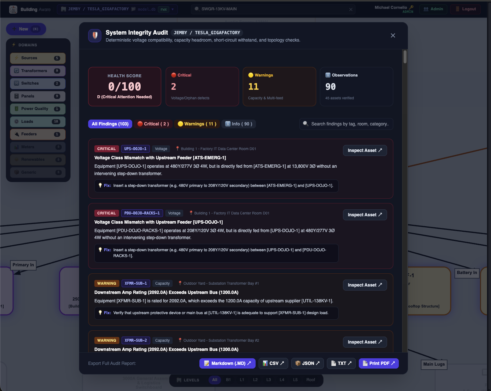

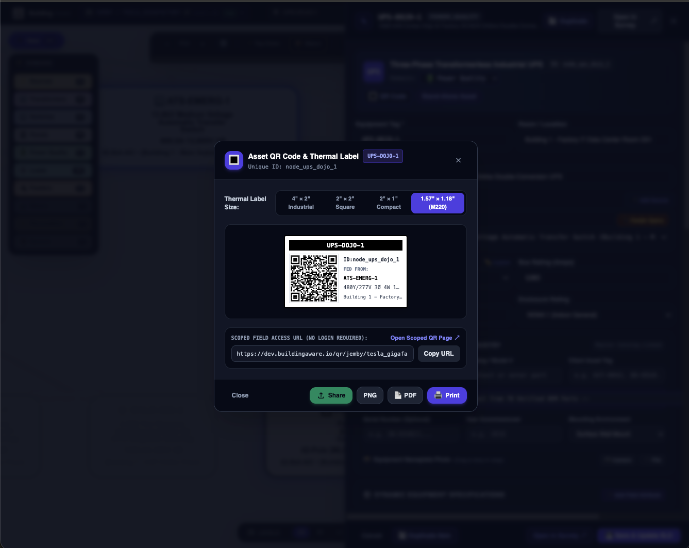

---

## Quick-Reference Summary (For Infographic & Slide Deck)

| Module / Control | How to Open | Primary Purpose |
| :--- | :--- | :--- |
| **Databases** | Facility DB Pill (`Cmd/Ctrl + O`) | Switch or create client/facility `model.db` twins (`rwx` permissions) |
| **Catalog Studio** | Toolbox (`🧰`) → `📖 Catalog Studio` | Standardize OEM equipment & breaker archetypes |
| **Survey Ledger** | Toolbox (`🧰`) → `📋 Survey Ledger` | Collect field assets, photos, checklists & `Fed From` links (`N` to add) |
| **Diagram** | Toolbox (`🧰`) → `⚡ Diagram` | Interactive power tree (`Cmd/Ctrl + K` or `/`, `H`, `M`, `0/R`, `+/-`) |
| **Feeders** | Header **`🔌 Feeders`** (`C`) | Inspect cable runs, NEC 310.16 ampacity & `<3%` voltage drop |
| **CAD SLD** | Header **`📐 CAD SLD`** | Generate IEEE 315 / ANSI sheets, schedule tables & AutoCAD `.DXF` |
| **Site Profile** | Header **`⚙️ Site Profile`** | Configure facility address, service voltage, utility & contacts |
| **Integrity Audit** | Toolbox (`🧰`) → `🛡️ Run Integrity Audit` | Automated NEC/IEEE topology checks & PDF/MD/CSV/JSONL export |
| **Field Guide** | Header **`?`** | Searchable FAQ, shortcuts & indexed safety/reference PDFs |

